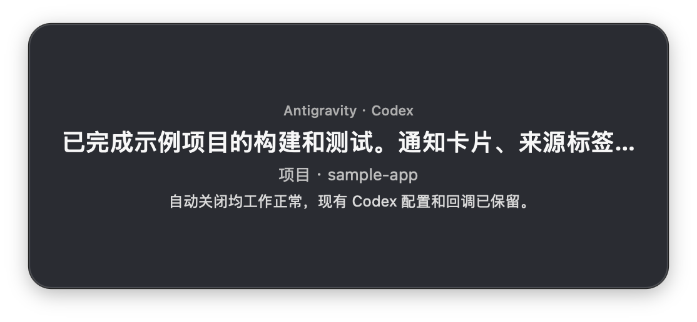
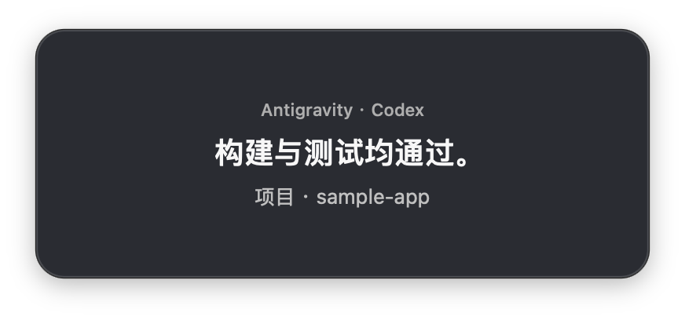
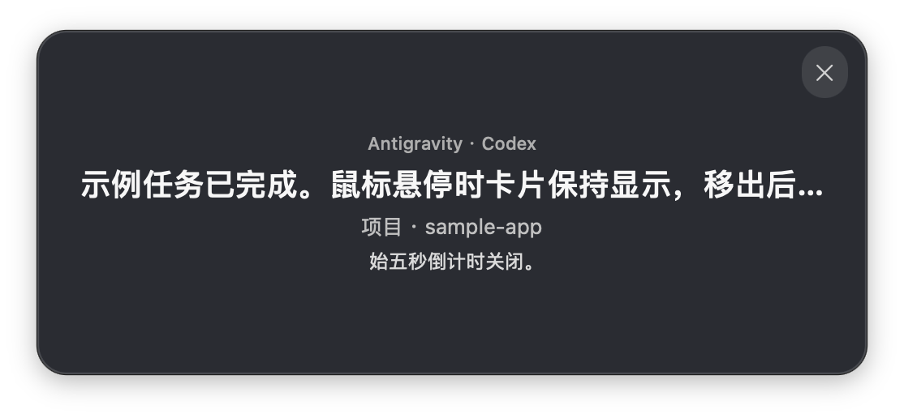

# Codex Center Notify for Antigravity

macOS 原生 Swift/AppKit 悬浮通知：Antigravity 中的 Codex 完成任务后，在屏幕中央显示结果。

## 功能

- 深色圆角 `NSPanel`，不抢键盘焦点，支持所有桌面空间。
- 优先显示在 Antigravity 所在屏幕；找不到窗口时使用主屏幕。
- 标题显示 Codex 最后回复开头（最多 24 字）；下方显示项目名和后续最多 60 字摘要。
- 卡片顶部以小字标注来源「Antigravity · Codex」。
- 播放系统提示音 Glass；悬停时暂停关闭倒计时并显示关闭按钮，鼠标移出卡片后立即关闭。
- 通过文件锁抑制并发重复弹窗。
- 仅当启动器进程祖先路径包含 Antigravity Plugin Helper 时显示；这是尽力过滤，需在目标扩展版本上实测。
- 不使用第三方依赖，不运行常驻服务。摘要只在本机屏幕显示。

## 界面截图

<table>
  <tr>
    <td align="center"><br>长回复显示摘要</td>
    <td align="center"><br>简短回复使用紧凑卡片</td>
    <td align="center"><br>鼠标悬停时显示关闭按钮</td>
  </tr>
</table>

截图使用合成示例内容，不包含真实项目路径。

## 环境要求

- macOS 与 Swift 编译器（Xcode Command Line Tools）。
- Antigravity 及 OpenAI Codex 扩展。
- Codex 用户级 `notify` 配置入口。

不需要安装第三方包或运行常驻后台服务。

## 安装（使用 Codex）

在 Codex 中打开本项目，把下面这段发给 Codex，并按提示允许所需的本机操作：

```text
请按本项目 README 安装 Codex Center Notify：先备份 ~/.codex/config.toml，再运行 ./scripts/install.sh。然后只修改 Codex 的 notify 设置，保留文件里的其他配置；如果已有 notify 回调，用启动器的 --forward 参数保留原命令和参数。完成后运行 ~/.codex/test-codex-center-notify.sh，并报告配置和测试结果。若无法安全合并配置，请先停止并说明原因，不要覆盖文件。
```

Codex 会编译并安装通知程序、合并完成事件回调，再运行测试。仓库不保存你的 `config.toml` 或备份。

## 卸载（使用 Codex）

在 Codex 中打开本项目，把下面这段发给 Codex：

```text
请卸载 Codex Center Notify：只从 ~/.codex/config.toml 的 notify 设置中移除本工具，并恢复安装前的原回调；不要改动其他配置。然后运行 ./scripts/uninstall.sh 并确认卸载结果。保留 config.toml 和备份文件。
```

卸载脚本在配置仍引用启动器时会停止，避免留下失效配置；它会保留配置文件和备份。

## 测试与事件限制

Codex 安装流程会运行 `~/.codex/test-codex-center-notify.sh`，检查卡片内容、窗口、Glass 是否启动、自动关闭和焦点状态。声音检查只确认系统开始播放；设备静音时仍可能听不到。

验证悬停与手动关闭：触发一条通知，在 5 秒内把鼠标移到卡片上，确认通知保持显示且右上角出现关闭图标；移出卡片或悬停时点击关闭图标，通知都应立即关闭。

要验证真实完成事件：重启 Antigravity，在临时工作区让 Codex 完成一条无文件修改的简单回复，确认通知出现。启动器通过进程祖先路径尽力排除 Codex CLI，不能保证所有宿主版本都能严格区分。

## 调整

- 时长：修改 `Sources/CodexCenterNotifyApp.swift` 中的 `notificationDuration`（默认 5 秒），再运行安装脚本重新编译。
- 声音：修改同一文件中的 `NSSound.Name("Glass")` 及对应系统音效路径，再运行安装脚本。
